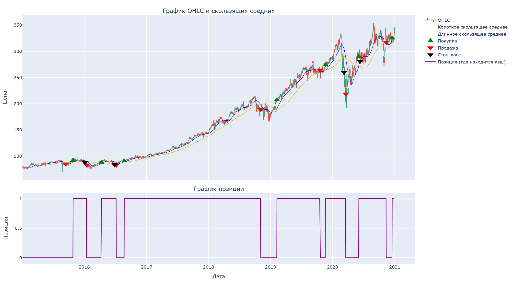

# Моделирование стратегии торговли акциями на основе ценовых трендов

Учебный проект на Python для исследования торговой стратегии на исторических котировках акций. Алгоритм рассчитывает простые скользящие средние, формирует сигналы покупки и продажи, моделирует сделки и применение стоп-лосса. Результаты представлены в журнале операций и на интерактивном графике Plotly.

Проект работает с историческими данными: заявки брокеру не отправляются, реальные сделки не совершаются.

## Возможности

- Загрузка дневных котировок через `yfinance`.
- Подготовка OHLC-данных в pandas.
- Расчёт двух простых скользящих средних (SMA).
- Определение сигналов по пересечению средних.
- Моделирование покупок и продаж по цене открытия следующего торгового дня.
- Покупка максимально доступного целого количества акций.
- Моделирование выхода по стоп-лоссу.
- Формирование таблицы сигналов и сделок.
- Интерактивная визуализация цен, средних, сигналов и позиции.

## Стек

Python, pandas, NumPy, yfinance, Plotly, Jupyter Notebook.

## Данные и параметры

Источник котировок — Yahoo Finance через библиотеку `yfinance`. В сохранённом примере используется тикер `MA` (Mastercard).

| Параметр | Значение в ноутбуке | Назначение |
|---|---|---|
| `money` | `1_000_000` | Начальный капитал |
| `start` | `datetime.datetime(2015, 1, 1)` | Начало периода |
| `finish` | `datetime.datetime(2020, 12, 31)` | Конечная граница запроса |
| `short_window` | `30` | Короткое окно SMA, торговые дни |
| `long_window` | `90` | Длинное окно SMA, торговые дни |
| `stop_loss` | `0.05` | Стоп-лосс: 5% от цены покупки |
| `ticker` | `'MA'` | Тикер акции |

`stop_loss` задаётся долей: `0.05` означает 5%, а не 0,05%.

В сохранённом выводе содержится 1 510 дневных наблюдений: с 2 января 2015 года по 30 декабря 2020 года. Конечная граница `end` в запросе `yfinance` не включается в выборку.

Исходные поля: `Open`, `High`, `Low`, `Close`. После подготовки дата хранится в столбце `Date`, а не в индексе.

## Логика стратегии

### Скользящие средние

Обе SMA рассчитываются по цене закрытия:

```python
info['short_sliding_window'] = info['Close'].rolling(short_window).mean()
info['long_sliding_window'] = info['Close'].rolling(long_window).mean()
```

До накопления достаточного количества наблюдений средние содержат пропуски, поэтому сигналы в начале периода не формируются.

### Сигналы и сделки

- `sig_buy`: короткая SMA пересекает длинную снизу вверх.
- `sig_sale`: короткая SMA пересекает длинную сверху вниз.
- Покупка моделируется по `Open` следующей торговой сессии; доступный остаток денег используется для покупки целого количества акций.
- Продажа по сигналу моделируется по `Open` следующей торговой сессии с закрытием позиции.
- Если следующего торгового дня в данных нет, сделка по сигналу не исполняется.

### Стоп-лосс

После покупки порог рассчитывается по формуле:

```python
stop_loss_price = last_price_buy * (1 - stop_loss)
```

При `Low < stop_loss_price` моделируется продажа всей позиции по цене стоп-лосса. Проверка выполняется также в день покупки. Стоп-лосс фиксирован относительно цены входа, а не следует за ростом цены.

## Журнал операций

Переменная `report` содержит события стратегии:

| Столбец | Содержание |
|---|---|
| `date` | Дата сигнала или сделки |
| `signal` | `sig_buy`, `buy`, `sig_sale`, `sale` или `stop-loss` |
| `num_shares` | Количество акций, записанное для события |
| `share_price` | Цена, записанная для события |
| `share_value` | Стоимость акций, записанная для события |
| `cash` | Остаток денежных средств |

В текущей реализации смысл части полей различается между событиями: например, строка продажи сохраняет количество проданных акций, хотя после сделки позиция уже закрыта. Поэтому таблицу следует читать как журнал событий, а не как единообразную оценку состояния портфеля на каждую дату.

## Визуализация



Интерактивный график Plotly состоит из двух частей:

1. **Цены и сигналы:** OHLC-график, короткая SMA синим цветом, длинная — оранжевым; сигналы покупки — зелёные маркеры, продажи — красные, стоп-лосса — чёрные.
2. **Индикатор позиции:** линия со значениями `0` и `1`.

График поддерживает масштабирование и просмотр значений при наведении.

## Запуск

Для запуска необходимы Python, Jupyter и доступ к интернету для загрузки котировок и ресурсов визуализации. Сохранённый ноутбук выполнялся на Python 3.9.6; версии зависимостей в переданных файлах не зафиксированы.

1. Сохраните ноутбук в папку проекта.
2. Создайте виртуальное окружение:

```bash
python -m venv .venv
```

3. Активируйте его.

Windows PowerShell:

```powershell
.\.venv\Scripts\Activate.ps1
```

Linux / macOS:

```bash
source .venv/bin/activate
```

4. Установите зависимости и откройте Jupyter:

```bash
python -m pip install numpy pandas pandas-datareader yfinance plotly notebook
python -m notebook
```

5. Откройте ноутбук, задайте параметры в начальном блоке и выполните ячейки последовательно сверху вниз. Для повторного расчёта перезапустите ядро и выполните все ячейки заново: торговый цикл изменяет состояние портфеля и дополняет журнал.


## Что демонстрирует проект

- Подготовку и преобразование финансовых временных рядов в pandas.
- Расчёт индикаторов через `rolling` и определение пересечений через `shift`.
- Моделирование торговых событий и учёт денежных средств.
- Формирование отчёта в DataFrame.
- Создание интерактивной визуализации в Plotly.

